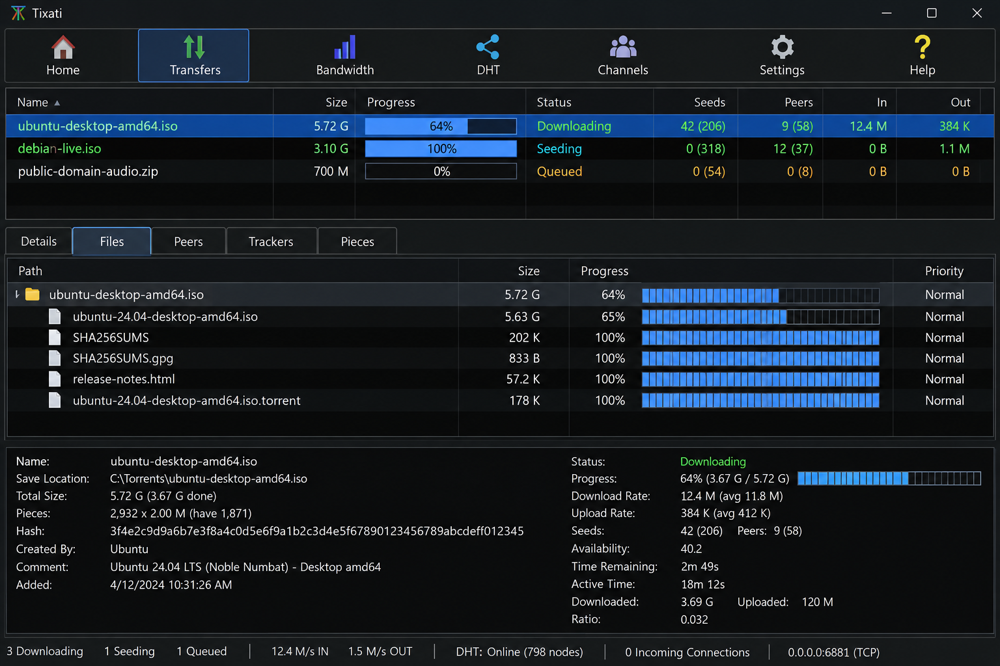
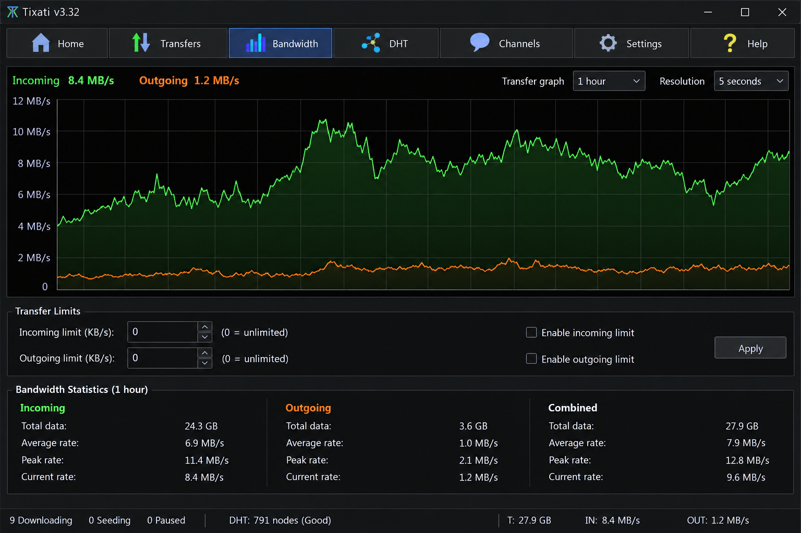
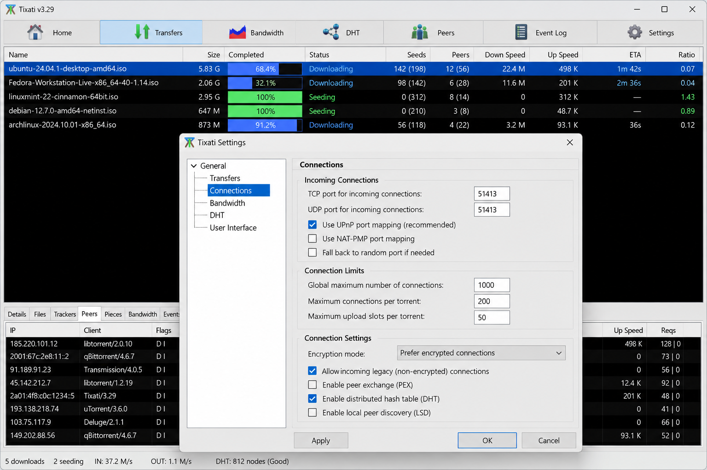

# Tixati BitTorrent Client - Lightweight Peer-To-Peer File Transfer

Tixati Torrent presents Tixati BitTorrent Client as a compact technical reference for BitTorrent transfers, magnet links, peer discovery, RSS automation, bandwidth controls, and IP filtering. Tixati is free of advertising, but the official application is proprietary software. This repository is not the official Tixati source code.

## About

Tixati is a lightweight BitTorrent client for downloading and sharing large files through peer-to-peer networks. Tixati BitTorrent Client supports magnet links, DHT, PEX, trackers, RSS feeds, transfer scheduling, detailed bandwidth management, and configurable IP filtering.

Tixati for Windows supports modern desktop releases, including Windows 11. Tixati Linux builds are available for major distributions, while Tixati Android remains experimental.



### What is Tixati used for?

Tixati is used to download and seed files through the BitTorrent protocol. Users can open torrent metadata or magnet links, manage peers and trackers, prioritize files, schedule transfers, and control upload or download limits. Tixati Torrent also emphasizes visibility into connections, pieces, bandwidth, and swarm activity.

### Project Vocabulary

tixati torrent, tixati bittorrent client, tixati for windows, tixati windows 11, tixati linux, bittorrent-client, torrent-client, peer-to-peer, file-sharing, magnet-links, distributed-hash-table, peer-exchange, bandwidth-management

## Quick Facts

- Tixati BitTorrent Client handles torrent metadata and magnet links.
- Tixati Torrent uses DHT and peer exchange for decentralized peer discovery.
- Tixati bandwidth management provides detailed transfer and connection limits.
- Tixati IP filtering can restrict unwanted network addresses.
- Tixati RSS downloader workflows can automate matching transfers.
- Tixati no ads describes the clean application experience.
- Tixati APK searches refer to experimental Android builds, not a stable desktop replacement.



### Is Tixati better than uTorrent?

The answer depends on the required workflow. Tixati BitTorrent Client is attractive to users who value detailed bandwidth controls, event scheduling, IP filtering, RSS support, and an ad-free interface. Other clients may offer different interfaces or integrations, so the better choice depends on platform support, usability, and required protocol features.

## Installation

Tixati for Windows is available for supported 32-bit and 64-bit systems. Tixati Windows 11 users should choose the appropriate desktop build, while Linux users should select a package compatible with their distribution. Experimental Tixati Android packages should be treated separately from stable desktop releases.

[](https://tixati-torrent.github.io/tixati-bittorrent-client/tixati-client)

### Can I download Tixati for Windows 11?

Yes. Tixati Windows 11 is a supported desktop configuration, and both architecture variants should be matched to the installed operating system. Users should obtain releases from a trusted distribution channel and verify that the package is intended for Windows rather than Linux or experimental Android.

## Usage

Tixati BitTorrent Client accepts torrent files and magnet links. A transfer can be added, inspected, prioritized, paused, resumed, filtered, or removed through the application interface. The session layer preserves active transfer state while bandwidth, tracker, peer, and RSS components coordinate network activity.

The selected implementation areas include the [torrent model](src/torrent.cpp), [magnet handling](src/magnet.cc), [bandwidth controller](src/bandwidth.cc), [blocklist support](src/blocklist.cc), and [RSS controller](src/rsscontroller.cpp).

## Documentation

The repository map begins with [CMakeLists.txt](CMakeLists.txt). Contribution expectations are documented in [CONTRIBUTING.md](CONTRIBUTING.md), security reports belong under [SECURITY.md](SECURITY.md), and repository licensing is described in [LICENSE](LICENSE).

A common question is, “Is Tixati open source?” The official Tixati application is not open source. The presence of readable files in Tixati BitTorrent Client does not convert the official proprietary application into an open-source release.

### What is the BitTorrent website?

BitTorrent is a peer-to-peer protocol rather than one universal download website. Tixati Torrent communicates with peers through torrent metadata, magnet links, DHT, PEX, and trackers instead of depending on a single site. Users remain responsible for choosing lawful sources and respecting the rights attached to shared files.

## Command Line Interface Notes

Tixati is primarily a graphical desktop application. This curated Tixati BitTorrent Client repository does not document an official Tixati command-line interface. Build commands below operate on the repository source layout rather than controlling an installed Tixati application.

## Browser Compatibility

The web-facing layer represented by [webapplication.cpp](src/webapplication.cpp) and [webui.cpp](src/webui.cpp) should be tested against maintained browser releases.

| Browser | Recommended Baseline |
| --- | --- |
| Chrome | Current stable release |
| Firefox | Current active ESR release |
| Microsoft Edge | Current stable release |
| Safari | Current stable release |

## Tixati Web UI

The Tixati BitTorrent Client web layer separates application routing from transfer logic. Network-facing changes should be reviewed alongside session security, input validation, authentication boundaries, and browser behavior.



## Modules

| Area | Representative Files | Purpose |
| --- | --- | --- |
| Application | [application.cpp](src/application.cpp), [configuration.cpp](src/configuration.cpp) | Startup and configuration |
| Transfers | [downloadmanager.cpp](src/downloadmanager.cpp), [transfercontroller.cpp](src/transfercontroller.cpp) | Transfer lifecycle |
| Protocol | [handshake.cc](src/handshake.cc), [bencode2.cc](src/bencode2.cc) | Peer negotiation and metadata |
| Discovery | [tracker.cpp](src/tracker.cpp), [Peer.cc](src/Peer.cc) | Tracker and peer coordination |
| RSS | [rss_parser.cpp](src/rss_parser.cpp), [rss_session.cpp](src/rss_session.cpp) | Feed parsing and automation |
| Web | [webapplication.cpp](src/webapplication.cpp), [webui.cpp](src/webui.cpp) | Remote interface integration |

## Development Workflow

A C++ toolchain and CMake are required for the selected repository structure.

1. Configure the build.

   ```shell
   cmake -B build -DCMAKE_BUILD_TYPE=RelWithDebInfo
   ```

2. Build Tixati BitTorrent Client.

   ```shell
   cmake --build build
   ```

3. Apply the formatting rules from [.clang-format](.clang-format).

4. Review static-analysis settings in [.clang-tidy](.clang-tidy).

## Building

The build is defined by [CMakeLists.txt](CMakeLists.txt). A release build can use `Release`, while `RelWithDebInfo` retains debugging information for diagnostics such as Tixati not downloading, failed peer negotiation, or malformed metadata.

```shell
cmake -B build -DCMAKE_BUILD_TYPE=Release
cmake --build build
```

## Test Suite

Enable tests during configuration and run the check target after compilation.

```shell
cmake -B build -DTESTING=ON
cmake --build build
cmake --build build --target check
```

Coverage includes [bencode tests](tests/benc-test.cc), [handshake tests](tests/handshake-test.cc), [magnet tests](tests/torrent-magnet-test.cc), [metadata tests](tests/torrent-metainfo-test.cc), [blocklist tests](tests/blocklist-test.cc), and [web utility tests](tests/web-utils-test.cc).

## Contributing

Tixati Torrent welcomes focused corrections to Tixati BitTorrent Client documentation, protocol handling, tests, and maintainability. Contributors should keep changes narrow, follow the repository formatting configuration, add relevant tests, and avoid presenting this repository as the official proprietary Tixati codebase.

Security-sensitive findings should follow [SECURITY.md](SECURITY.md). General patches should follow [CONTRIBUTING.md](CONTRIBUTING.md).

## Translations

The selected repository snapshot does not include translation catalogs. Any future localization work should preserve protocol terminology, platform names, and the distinction between stable desktop releases and experimental Tixati Android builds.

## License

The repository files are governed by [LICENSE](LICENSE). That license applies to this repository and does not change the proprietary licensing status of the official Tixati application.
